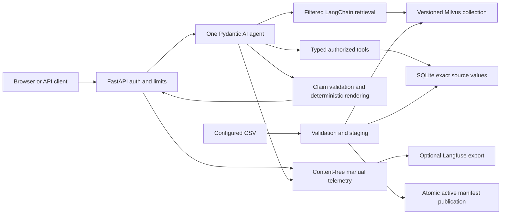

# Architecture

Authentication and customer scope are server-controlled. Every source lookup and tool authorizes independently. One immutable active snapshot joins the source SQLite database, vector collection, schema, embedding configuration, checksum and dataset version. Staging validates source data and vector completeness before one atomic manifest replacement. Failure preserves the previous active version.

The sole agent loop is Pydantic AI. LangChain provides documents, embedding integration and filtered retrieval. Exact integer-paise calculations stay in deterministic Python tools. The model emits typed claims; a validator checks source/metric, scope, value and unit, and renderer generates factual prose from validated claims. A reference field alone cannot validate an unsupported factual claim.

Production never falls back to a fake provider. The explicit demo launcher injects a synthetic fixture, a deterministic Pydantic AI FunctionModel and synthetic retrieval. HTTP handlers run blocking analytics/ingestion outside the event loop. Rate limiting, ingestion coordination and completed job retention are process-local; one worker is the supported deployment shape.
